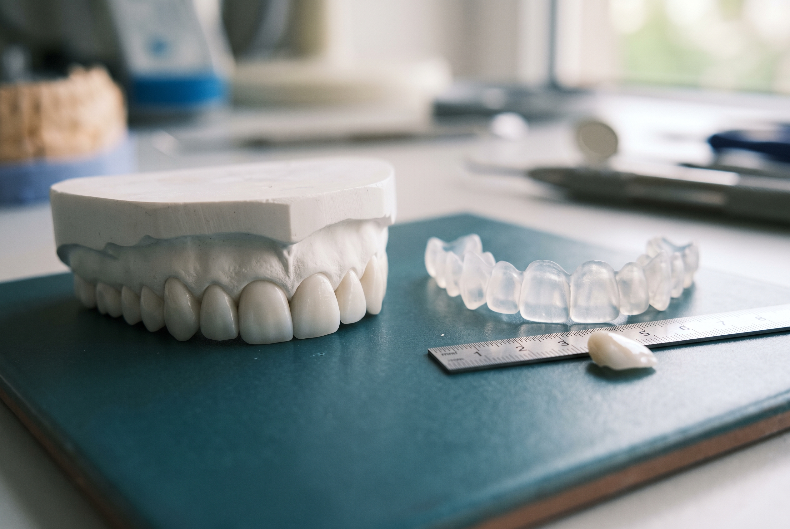

## RESPUESTA CORTA

El diseño de sonrisa digital es la etapa de planificación de un cambio de sonrisa. Con fotos, video y un escaneo 3D de tu cara y tus dientes, la nueva sonrisa se dibuja primero sobre tu propio rostro, siguiendo tu línea labial, la línea media de tu cara y las proporciones de tus dientes, y después se convierte en un encerado y un mock-up que ves en tu boca. Solo cuando apruebas esa vista previa se prepara algún diente. En Xiluet Smiles el diseño, la vista previa y los cambios están incluidos en los $6,999 de las 20 carillas.

## El diseño de sonrisa es un plan, las carillas son un material

La gente busca "diseño de sonrisa" y "carillas" como si fueran dos tratamientos. Son dos etapas de un mismo tratamiento. Las carillas, las coronas, la resina o los alineadores son los materiales y los métodos. El diseño de sonrisa es la decisión sobre qué deben producir esos materiales: qué largo deben tener los dientes frontales, dónde deben apoyar sus bordes contra tu labio inferior, qué tan ancha debe ser la sonrisa, qué tono le va a tu piel y cómo debe relacionarse cada diente con el de al lado.

Una clínica que se salta la etapa de diseño puede cementar veinte carillas igual. Lo que no puede hacer es decirte de antemano cómo van a quedar, ni cambiar de opinión sin rehacer porcelana. De ahí salen la mayoría de las sonrisas que se ven falsas, y las señales las explicamos en [por qué algunas carillas se ven falsas](/es/blog/por-que-algunas-carillas-se-ven-falsas). Este artículo trata de lo que viene antes: cómo se construye realmente un diseño.

## Qué aporta lo "digital"

El diseño de sonrisa existía antes del software. Los dentistas dibujaban sobre fotos impresas y pedían al ceramista que tallara un modelo de cera. La versión digital, popularizada a partir de 2007 bajo el nombre Digital Smile Design, pasó el dibujo a una pantalla y lo conectó con el escáner y el laboratorio.

La diferencia práctica para ti está en cuatro puntos.

- **El diseño se hace sobre tu cara, no sobre un modelo.** Las fotos faciales y un video corto tuyo hablando y riendo son el lienzo. Los dientes se dibujan en proporción a tus labios, tus ojos y la línea media de tu rostro, no sobre un molde de yeso sin cara alrededor.
- **El diseño se puede imprimir.** Cuando el dibujo se aprueba en pantalla, se convierte en un modelo 3D y en un encerado. De ese encerado salen el mock-up y los provisionales, así que lo que viste es lo que llevas puesto.
- **Cambiar es barato mientras la porcelana no existe.** Acortar un diente medio milímetro en pantalla toma un minuto. Hacerlo después de cementar significa rehacer la carilla.
- **El ceramista ve el mismo archivo.** En Xiluet el ceramista trabaja en el edificio y usa el mismo archivo de diseño que el doctor, así que nada se reinterpreta desde una foto enviada por correo a otra ciudad.

## Las cinco medidas de las que parte todo diseño

Cualquier diseño que te muestren, de cualquier clínica, debería poder señalar estas cinco referencias. Si el dentista no sabe decir de dónde salió una línea, la línea salió del catálogo.

1. **Línea media facial.** Una línea vertical por el centro de la cara, normalmente desde el entrecejo hasta el centro del mentón. Los dos incisivos centrales deben encontrarse sobre ella, o a menos de un milímetro. Una sonrisa recta pero descentrada se ve mal sin que nadie sepa decir por qué.
2. **Línea bipupilar.** La línea horizontal que pasa por las pupilas. Los bordes de los dientes frontales superiores deben ir paralelos a ella. Una sonrisa inclinada, que se ladea con la cabeza, es uno de los defectos más comunes en los casos hechos con prisa.
3. **Línea labial en reposo y sonriendo.** Cuánto diente se ve con los labios relajados, normalmente de 2 a 4 mm de los incisivos centrales, y cuánta encía se ve en una sonrisa completa. Esto define el largo de los dientes y nos dice si hay que remodelar la encía antes de cualquier carilla.
4. **Arco de la sonrisa.** La curva de los bordes de los dientes superiores debe seguir la curva del labio inferior. Bordes planos sobre un labio curvo dan el aspecto de "teclas de piano". Bordes que bajan por debajo del labio se ven largos y cambian cómo pronuncias la F y la V.
5. **Proporción dental.** Los incisivos centrales se ven bien cuando su ancho es alrededor del 75 al 80 por ciento de su largo. Vistos de frente, cada diente hacia atrás se ve más estrecho en una proporción bastante constante, de modo que los laterales parecen un 60 a 70 por ciento del ancho de los centrales y los caninos más estrechos todavía. Haz todos los dientes del mismo ancho y tendrás la cerca de madera.

## Del dibujo a la boca: encerado, mock-up, provisionales

Esta es la secuencia, y el sentido de cada paso, tal como transcurre en la semana de Xiluet.

| Paso | Qué es | Para qué sirve | Cuándo |
| --- | --- | --- | --- |
| Fotos y video | Fotos de frente y de perfil, un video corto hablando y riendo | El lienzo del diseño; captura cómo se mueven de verdad tus labios | Desde casa, y otra vez en la Visita 1 |
| Escaneo 3D | Una impresión digital de ambas arcadas y de tu mordida | Sustituye los moldes de pasta; alimenta el modelo impreso | Visita 1 |
| Diseño digital | Dientes dibujados sobre tu cara con las cinco referencias | Decidir largo, ancho, posición del borde, arco y tono | Visita 1, unas 2 horas incluyendo el examen |
| Encerado | El diseño impreso como modelo físico de los dientes nuevos | Plantilla para el mock-up y los provisionales | La noche después de la Visita 1 |
| Mock-up | Resina aplicada sobre tus dientes intactos desde un molde del encerado | Ves y llevas el diseño, en el espejo, en fotos, hablando | Visita 1 o 2 |
| Provisionales | Dientes de resina con la forma final, dos días puestos | Convivir con el diseño; reportar cualquier cambio | De la Visita 2 a la Visita 3 |
| Porcelana final | Estratificada a mano por el ceramista interno a partir del archivo aprobado | Se cementa solo después de una prueba | Visita 3 |

El mock-up es el paso que más recortan las clínicas que anuncian un precio y una visita. También es el único paso que te permite decir "más corto" o "más cálido" antes de tocar el esmalte. Si una clínica no puede mostrarte el diseño en tu boca, pregunta por qué.

## Sonrisa de Hollywood o tu sonrisa

"Sonrisa de Hollywood" es una de las frases más buscadas en esta categoría, y suele significar dos cosas a la vez: una sonrisa blanca, pareja y completa, y una sonrisa un poco artificial. La primera es un objetivo de diseño. La segunda es un fallo de diseño.

Un buen diseño toma prestada la estructura de una sonrisa famosa, cada diente visible en un solo tono, un arco amplio, sin rincones oscuros, y la mantiene dentro de los límites de tu propia cara: un tono no más blanco que el blanco de tus ojos, incisivos del tamaño de tu línea labial, caninos con punta y pequeñas asimetrías dejadas a propósito. Cuando te ponen el mock-up, eso es lo que estás revisando. ¿La cara sigue pareciendo la tuya, con mejores dientes, o los dientes llegan antes que tú?

## Cuánto cuesta un diseño de sonrisa en Miami

Algunas prácticas de Miami cobran la etapa de diseño por separado, normalmente entre $300 y $1,500 por fotografía, diseño digital y mock-up, a veces descontados si sigues adelante. Otras lo incluyen en un precio por carilla de $900 a $2,500. Una cotización de "smile makeover" en Miami suele quedar entre $8,000 y $14,000 por el juego completo, antes de blanqueamiento, remodelado de encía o visitas extra.

En Xiluet Smiles el diseño, el mock-up y los cambios forman parte de los $6,999 de las 20 carillas de porcelana, que también cubren el examen, la limpieza, las radiografías, el laboratorio interno y una garantía de 5 años por escrito. La cifra se confirma por escrito en menos de 6 horas desde que recibimos tus fotos. Los procedimientos que no son carillas, como remodelar la encía o una corona en un diente con mucha obturación, se cotizan por separado y por escrito antes de que viajes. El desglose completo está en [cuánto cuestan las carillas de porcelana en Miami](/es/blog/precio-carillas-de-porcelana-miami).

## Cómo evaluar un diseño que te muestren

Ya sea que estés mirando una pantalla en nuestra consulta o un render que te envió otra clínica, repasa estas seis comprobaciones.

1. ¿Los centrales están sobre la línea media de tu cara, no solo sobre la línea media de tus dientes?
2. ¿Los bordes van paralelos a tus ojos?
3. ¿La línea de los bordes sigue tu labio inferior o lo cruza en línea recta?
4. ¿Los centrales son los dientes más grandes, con laterales y caninos bajando de tamaño?
5. ¿El tono se eligió contra tu piel y tus ojos con luz de día, o contra la pestaña más blanca?
6. ¿Puedes llevarlo en la boca antes de preparar nada?

Seis síes significan que el diseño se hizo para ti. Un no es una conversación que hay que tener antes del depósito, no después.

> Un diseño que no puedes llevar puesto es un dibujo. El mock-up es el momento en que pasa a ser tu decisión y no la nuestra.
>
> DRA. GRETELL ALONSO FIEL, DMD

Envía tres fotos a través de la [evaluación gratuita por fotos](/es/evaluacion-gratuita-por-fotos) y un doctor te responderá en menos de 6 horas con lo que implicaría un diseño para tu cara, cuánto cuesta y las fechas de tu semana. Si prefieres ver primero diseños terminados, empieza por nuestros [casos de antes y después](/es/antes-y-despues).

## Preguntas relacionadas

### ¿Cuál es la diferencia entre diseño de sonrisa y carillas?

El diseño de sonrisa es la planificación: las medidas, el dibujo sobre tu cara y el mock-up que apruebas. Las carillas son la porcelana que se fabrica a partir de ese plan. Puedes tener carillas sin diseño, y mucha gente las tiene, y por eso algunas carillas se ven falsas. No puedes tener un buen diseño sin elegir, al final, un material para construirlo.

Dra. Gretell Alonso Fiel, DMD

### ¿Cuánto tarda el diseño de sonrisa digital?

La sesión de diseño en la Visita 1 toma unas dos horas incluyendo el examen, los escaneos y las fotos. El encerado se imprime esa noche y el mock-up se coloca a la mañana siguiente. Todo el proceso, desde las primeras fotos hasta la porcelana final, va de lunes a jueves en Xiluet porque el laboratorio está en el edificio.

Dra. Marta Puentes Marrero, DMD

### ¿Puedo ver mi diseño de sonrisa antes de pagar?

Ves el presupuesto por escrito antes de pagar nada. El diseño en sí se construye en la Visita 1, después del depósito de $250, porque necesita los escaneos y las fotos faciales que tomamos en persona. Después ves y llevas el mock-up antes de preparar cualquier diente, y no se talla nada hasta que lo apruebas.

Dra. Gretell Alonso Fiel, DMD

### ¿La sonrisa de Hollywood es lo mismo que el diseño de sonrisa?

No. "Sonrisa de Hollywood" describe un resultado: blanca, pareja, completa. El diseño de sonrisa es el método que decide qué tan blanca, qué tan pareja y qué tan completa le va a tu cara. Un diseño puede darte una sonrisa estilo Hollywood que siga pareciendo tuya, o puede evitar que elijas una que no lo sería.

Dr. Roger Ramos Navarro, DMD

### ¿El diseño de sonrisa siempre significa carillas?

No. El diseño decide qué tiene que cambiar. A veces la respuesta es blanqueamiento y dos carillas, a veces alineadores primero y carillas después, a veces solo remodelar la encía. En Xiluet la mayoría de los diseños se construyen con 20 carillas porque eso cubre cada diente que se ve, pero un doctor te dirá por escrito si menos, u otra cosa, te conviene más.

Dra. Marta Puentes Marrero, DMD

### ¿Qué software se usa para el diseño de sonrisa digital?

Existen varias plataformas, y el software importa menos que las referencias con las que se usa. Lo que debes preguntar es si el diseño se dibujó sobre tus fotos y tu video facial, si se imprimió en un encerado y un mock-up que puedes llevar, y si el ceramista trabaja desde el mismo archivo. Esas tres cosas, y no la marca, deciden el resultado.

Dra. Gretell Alonso Fiel, DMD
