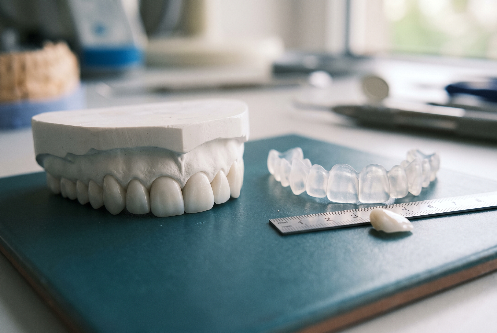

## SHORT ANSWER

Digital smile design is the planning stage of a smile makeover. Photos, video and a 3D scan of your face and teeth are used to draw the new smile over your own face first, following your lip line, facial midline and tooth proportions, and then to make a wax-up and a mock-up you can see in your mouth. Only after you approve that preview is any tooth prepared. At Xiluet Smiles the design, the preview and any changes are included in the $6,999 fee for 20 veneers.

## Smile design is a plan, veneers are a material

People search for "smile design" and "veneers" as if they were two treatments. They are two stages of one treatment. Veneers, crowns, bonding or aligners are the materials and methods. Smile design is the decision about what those materials should produce: how long the front teeth should be, where their edges should sit against your lower lip, how wide the smile should be, what shade suits your skin, and how each tooth should relate to its neighbour.

A clinic that skips the design stage can still bond twenty veneers. What it cannot do is tell you beforehand what they will look like, or change its mind without remaking porcelain. That is where most fake-looking smiles come from, and we wrote about the tells in [why some veneers look fake](/blog/why-veneers-look-fake). This article is about the part that comes before: how a design is actually built.

## What "digital" adds

Smile design existed before software. Dentists drew on printed photos and asked a ceramist to carve a wax model. The digital version, popularised from about 2007 onward under the name Digital Smile Design, moved the drawing onto a screen and connected it to the scanner and the lab.

The practical difference for you is in four places.

- **The design is done on your face, not on a model.** Facial photos and a short video of you talking and laughing are the canvas. Teeth are drawn in proportion to your lips, eyes and the midline of your face, not to a plaster cast with no face around it.
- **The design can be printed.** Once the drawing is approved on screen, it is turned into a 3D model and a wax-up. That wax-up is what the mock-up and the temporaries are made from, so what you saw is what you wear.
- **Changes are cheap before porcelain exists.** Shortening a tooth by half a millimetre on screen takes a minute. Doing it after bonding means remaking the veneer.
- **The ceramist sees the same file.** At Xiluet the ceramist works in the building and uses the same design file as the doctor, so nothing is re-interpreted from a photo emailed to another city.

## The five measurements every design starts from

Any design you are shown, from any clinic, should be able to point to these five references. If the dentist cannot say where a line came from, the line came from the catalogue.

1. **Facial midline.** A vertical line through the centre of the face, usually taken from between the eyebrows to the centre of the chin. The two central incisors should meet on it, or within a millimetre of it. A smile that is straight but off-centre looks wrong without anyone being able to say why.
2. **Interpupillary line.** The horizontal line through the pupils. The edges of the upper front teeth should run parallel to it. A canted smile, one that tilts with the head, is one of the most common faults in rushed cases.
3. **Lip line at rest and smiling.** How much tooth shows when the lips are relaxed, usually 2 to 4 mm of the upper central incisors, and how much gum shows at a full smile. This sets tooth length and tells us whether the gum line needs reshaping before any veneer.
4. **Smile arc.** The curve of the upper teeth edges should follow the curve of the lower lip. Flat edges across a curved lip is the "piano key" look. Edges that dip below the lip look long and change how you pronounce F and V sounds.
5. **Tooth proportion.** Central incisors look right when their width is about 75 to 80 percent of their length. From the front, each tooth back from the centrals appears narrower by a fairly constant ratio, so the laterals look about 60 to 70 percent as wide as the centrals and the canines narrower again. Make every tooth the same width and you get the picket fence.

## From drawing to mouth: wax-up, mock-up, temporaries

Here is the sequence, and the point of each step, as it runs during the Xiluet week.

| Step | What it is | What it is for | When |
| --- | --- | --- | --- |
| Photos and video | Frontal and profile photos, a short video of you speaking and laughing | The canvas for the design; captures how your lips actually move | From home, and again at Visit 1 |
| 3D scan | A digital impression of both arches and your bite | Replaces putty moulds; feeds the printed model | Visit 1 |
| Digital design | Teeth drawn over your face using the five references | Decide length, width, edge position, arc and shade | Visit 1, about 2 hours including the exam |
| Wax-up | The design printed as a physical model of the new teeth | Template for the mock-up and temporaries | Overnight after Visit 1 |
| Mock-up | Resin pressed over your untouched teeth from a mould of the wax-up | You see and wear the design, in a mirror, in photos, while talking | Visit 1 or 2 |
| Temporaries | Resin teeth in the final shape, worn two days | Live with the design; report anything to change | Visit 2 to Visit 3 |
| Final porcelain | Hand-layered by the in-house ceramist from the approved file | Bonded only after a try-in | Visit 3 |

The mock-up is the step most often cut by clinics that advertise one price and one visit. It is also the only step that lets you say "shorter" or "warmer" before any enamel is touched. If a clinic cannot show you the design in your mouth, ask why.

## Hollywood smile or your smile

"Hollywood smile" is one of the most searched phrases in this category, and it usually means two things at once: a bright, even, full smile, and a slightly unnatural one. The first is a design goal. The second is a design failure.

A good design borrows the structure of a famous smile, every visible tooth in one shade, a wide smile arc, no dark corners, and keeps it inside the limits of your own face: a shade no whiter than the whites of your eyes, incisors sized to your lip line, canines with a point, and small asymmetries kept on purpose. When the mock-up goes in, that is what you are checking. Does the face still look like you, with better teeth, or do the teeth arrive before you do?

## What smile design costs in Miami

Some Miami practices bill the design stage separately, typically $300 to $1,500 for photography, a digital design and a mock-up, sometimes credited back if you go ahead. Others fold it into a per-tooth veneer price of $900 to $2,500. A "smile makeover" quote in Miami commonly lands between $8,000 and $14,000 for a full set, before whitening, gum reshaping or extra visits.

At Xiluet Smiles the design, the mock-up and changes to it are part of the $6,999 fee for 20 porcelain veneers, which also covers the exam, cleaning, X-rays, the in-house lab and a 5-year written warranty. The number is confirmed in writing within 6 hours of receiving your photos. Procedures other than veneers, such as gum reshaping or a crown on a heavily filled tooth, are quoted separately in writing before you travel. The full breakdown is in [how much porcelain veneers cost in Miami](/blog/porcelain-veneers-cost-miami).

## How to judge a design you are shown

Whether you are looking at a screen in our office or a rendering another clinic sent you, run through these six checks.

1. Do the centrals sit on the midline of your face, not just the midline of your teeth?
2. Do the edges run parallel to your eyes?
3. Does the edge line follow your lower lip, or cut straight across it?
4. Are the centrals the biggest teeth, with laterals and canines stepping down?
5. Is the shade chosen against your skin and eyes in daylight, or against the whitest tab?
6. Can you wear it in your mouth before anything is prepared?

Six yeses means the design was built for you. One no is a conversation to have before the deposit, not after.

> A design you cannot wear is a drawing. The mock-up is the moment it becomes your decision instead of ours.
>
> DR. GRETELL ALONSO FIEL, DMD

Send three photos through the [free photo evaluation](/free-photo-evaluation) and a doctor will reply within 6 hours with what a design for your face would involve, what it costs, and the dates for your week. If you want to see finished designs first, start with our [before and after cases](/before-and-after).

## Related questions

### What is the difference between smile design and veneers?

Smile design is the planning: the measurements, the drawing on your face and the mock-up you approve. Veneers are the porcelain made from that plan. You can have veneers without a design, and many people do, which is why some veneers look fake. You cannot have a good design without eventually choosing a material to build it in.

Dr. Gretell Alonso Fiel, DMD

### How long does digital smile design take?

The design session at Visit 1 takes about two hours including the exam, scans and photos. The wax-up is printed overnight and the mock-up goes in the next morning. The whole process, from first photos to final porcelain, runs Monday to Thursday at Xiluet because the lab is in the building.

Dr. Marta Puentes Marrero, DMD

### Can I see my smile design before I pay?

You see the written estimate before you pay anything. The design itself is built at Visit 1, after the $250 deposit, because it needs the scans and facial photos we take in person. You then see and wear the mock-up before any tooth is prepared, and nothing is drilled until you approve it.

Dr. Gretell Alonso Fiel, DMD

### Is a Hollywood smile the same as smile design?

No. "Hollywood smile" describes a result: bright, even, full. Smile design is the method that decides how bright, how even and how full suits your face. A design can give you a Hollywood-style smile that still looks like yours, or it can stop you from choosing one that would not.

Dr. Roger Ramos Navarro, DMD

### Does smile design always mean veneers?

No. The design decides what has to change. Sometimes the answer is whitening and two veneers, sometimes aligners first and veneers after, sometimes gum reshaping on its own. At Xiluet most designs are built in 20 veneers because that covers every tooth that shows, but a doctor will tell you in writing if fewer, or something else, would serve you better.

Dr. Marta Puentes Marrero, DMD

### What software is used for digital smile design?

Several platforms exist, and the software matters less than the references it is used with. What you should ask is whether the design was drawn over your facial photos and video, whether it was printed into a wax-up and a mock-up you can wear, and whether the ceramist works from the same file. Those three things, not the brand name, decide the result.

Dr. Gretell Alonso Fiel, DMD
