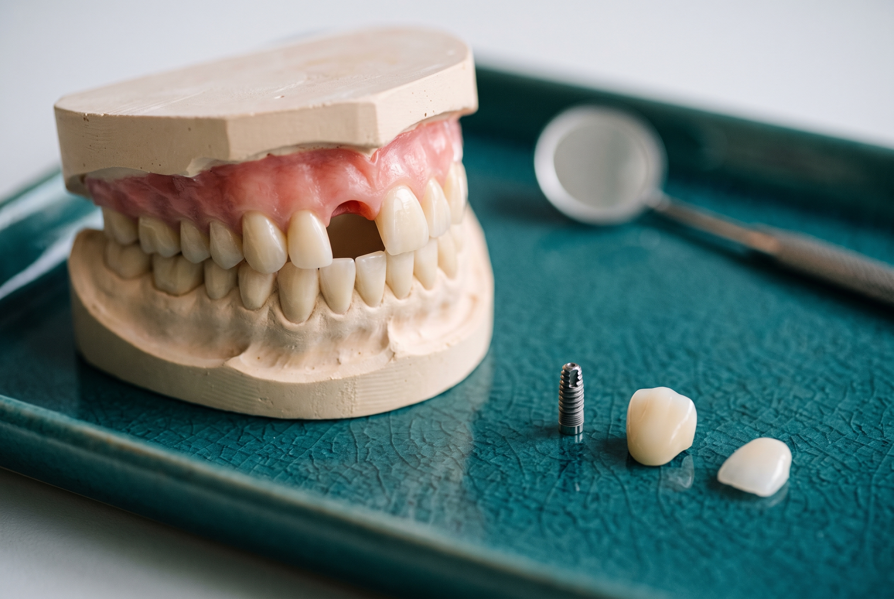

## RESPUESTA CORTA

La mayoría de los adultos con encías sanas y suficiente esmalte son candidatos para carillas de porcelana. Las carillas cierran espacios de hasta unos 2 a 3 mm, alargan dientes pequeños o desgastados, cubren manchas que el blanqueamiento no quita y enderezan el aspecto de dientes levemente apiñados o rotados. No pueden reemplazar un diente que falta, corregir una mordida ni cementarse sobre encías inflamadas o dientes con grandes obturaciones. En esos casos algo va primero, y un doctor te dice qué, por escrito y a partir de tus fotos, antes de que viajes.

## Lo que una carilla puede y no puede hacer

Una carilla de porcelana es una lámina de 0.3 a 0.7 mm cementada al frente de un diente. Cambia el color, la forma, el largo y la posición aparente del diente que cubre. No mueve la raíz, no reemplaza un diente que no está y depende de que el esmalte y la encía debajo estén lo bastante sanos para adherirse y convivir durante quince años.

Esa sola frase resuelve casi todas las preguntas de "¿puedo ponerme carillas con...?". Si el problema está en la superficie de un diente que existe, las carillas suelen ser la respuesta. Si el problema está debajo, en la posición de las raíces, en la encía o en el hueco donde antes había un diente, algo tiene que pasar primero.

## Problema por problema

La tabla de abajo es la respuesta que damos más a menudo. Las notas que la siguen explican los casos límite.

| Tu situación | ¿Carillas solas? | Lo que normalmente va primero | Notas |
| --- | --- | --- | --- |
| Manchas que el blanqueamiento no quita (tetraciclina, fluorosis, diente desvitalizado) | Sí | Nada | Los dientes oscuros necesitan porcelana un poco más opaca o algo más de preparación |
| Bordes astillados o desgastados | Sí | Una placa nocturna si el desgaste viene de rechinar | Si no, los bordes nuevos se desgastan igual |
| Espacio entre los dientes frontales de hasta 2 a 3 mm | Sí | Nada | Espacios mayores dejan los dos dientes demasiado anchos; alineadores primero |
| Dientes pequeños o cortos, sonrisa "gingival" | Normalmente | Remodelado de encía en algunos casos | Alargar un diente hacia abajo es porcelana; alargarlo hacia arriba es encía |
| Apiñamiento o rotación leve | Sí | Nada | Las carillas disimulan la posición; no la cambian |
| Apiñamiento moderado a severo o mordida cruzada | No solas | Alineadores o brackets, después carillas | Las carillas sobre una mala mordida se astillan y fallan pronto |
| Uno o más dientes faltantes | No | Implante o puente para el hueco, carillas en el resto | Una carilla necesita un diente debajo |
| Retracción de encías | Caso por caso | La retracción debe estar estable; a veces un injerto | La raíz expuesta no es esmalte y se adhiere peor |
| Obturaciones grandes y viejas en un diente frontal | A menudo una corona | Nada, pero cambia el material | Una carilla sobre casi pura obturación tiene poco esmalte que la sujete |
| Enfermedad de encías o caries activa | No | Tratamiento primero | Cementar sobre encía inflamada falla y esconde la enfermedad |
| Rechinar los dientes | Sí, con placa | Una placa nocturna todas las noches | No es opcional para quien rechina |
| Menos de 18 años | Normalmente no | Esperar a que termine el crecimiento | La línea de la encía y la posición dental siguen cambiando |

## Espacios, dientes pequeños y apiñamiento: los casos para los que se inventaron las carillas

Un espacio entre los dientes frontales es el caso clásico de carillas. Cada incisivo central se hace un poco más ancho para que los dos se encuentren en el medio. Hasta unos 2 mm el cambio es invisible. Alrededor de 3 mm los dientes empiezan a verse cuadrados. Más allá, cerrar el espacio solo con porcelana produce dos dientes frontales muy anchos, y unos meses de alineadores primero dan mejor resultado.

Los dientes pequeños o cortos son el segundo caso clásico, y la primera pregunta es hacia dónde tienen que crecer. Si tus dientes se ven cortos porque los bordes están desgastados o siempre fueron cortos, la porcelana añade largo en el borde. Si se ven cortos porque la encía los cubre demasiado, la solución son unos milímetros de remodelado de encía en la Visita 1 y después carillas a la medida de la nueva línea gingival. Muchos casos de "sonrisa gingival" son una mezcla de ambos, y el diseño decide la proporción antes de tocar nada.

El apiñamiento y la rotación leves son donde las carillas se ganan el nombre de "ortodoncia instantánea". Un diente que queda un poco detrás de sus vecinos o girado unos grados se puede adelantar y cuadrar en porcelana en una semana en lugar de un año de alineadores. El límite es cuánto está fuera de línea. Cubrir un diente muy retrasado implica una carilla gruesa; cubrir uno muy adelantado implica desgastarlo, y de ahí vienen las historias de "las carillas arruinan los dientes". Esa frontera la explicamos en [¿las carillas arruinan tus dientes?](/es/blog/las-carillas-arruinan-los-dientes).

## Dientes faltantes: carillas vs implantes

"¿Puedo ponerme carillas si me faltan dientes?" es una de las preguntas más buscadas de esta categoría, y la respuesta honesta es que una carilla necesita un diente debajo. Donde hay un hueco, necesitas algo que reemplace el diente entero.

- **Un implante** es un poste de titanio colocado en el hueso con una corona de porcelana encima. Es la respuesta estándar para un solo diente faltante con hueso sano alrededor. El implante necesita unos tres o cuatro meses para integrarse antes de la corona final, así que un caso con implante lleva un calendario más largo que una semana de carillas.
- **Un puente** usa los dos dientes vecinos como anclaje para un diente de reemplazo entre ellos. Es más rápido que un implante y evita la cirugía, a cambio de poner coronas en dos dientes que quizás solo habrían necesitado una carilla.
- **Carillas en todo lo demás.** Una vez resuelto el hueco, el resto de los dientes frontales se cubren con carillas del mismo tono y diseño, de modo que la corona del implante o el puente y las carillas se planifican juntos. Eso es lo que significa un smile makeover cuando faltan uno o dos dientes.

Si falta o está fallando la mayor parte de una arcada, los implantes individuales y las carillas dejan de tener sentido y lo tiene una solución de arcada completa. Esa comparación está en [All-on-4 vs All-on-6 vs reconstrucción bucal completa](/es/blog/all-on-4-vs-all-on-6-vs-reconstruccion-bucal-completa).

## Encías: retracción y enfermedad

Las carillas viven en la línea de la encía, así que la encía decide más de lo que la gente espera.

La enfermedad de encías activa descarta las carillas hasta que se trata. Una encía que sangra e inflamada alrededor del margen de una carilla nueva significa que el margen se colocó sobre enfermedad, y tanto la encía como la adhesión se deterioran. Una limpieza o limpieza profunda en la Visita 1 está incluida en nuestra semana; una periodontitis establecida se trata primero, y la semana de carillas se agenda después.

La retracción tiene más matices. Cuando la encía se ha retirado y expone parte de la raíz, la superficie de la raíz no es esmalte. La porcelana se adhiere al esmalte mucho mejor que a la raíz, así que una carilla que tiene que cubrir mucha raíz expuesta es una carilla más débil. Si la retracción es estable y moderada, el margen de la carilla se diseña para terminar donde termina el esmalte y la raíz expuesta se maneja por separado. Si la retracción está activa o es profunda, primero va un injerto de encía. Un doctor lo ve en una foto cercana de tu línea de encía, que es una de las tres fotos que pedimos.

## Después de Invisalign o brackets

Carillas después de alineadores es una de las mejores combinaciones de la odontología estética, y cada vez más común. Los alineadores ponen las raíces donde deben estar, así que las carillas pueden ser finas y uniformes. Las carillas arreglan después lo que los alineadores no pueden: forma, color, bordes desgastados, dientes pequeños.

Dos reglas de tiempos. Primera, termina la ortodoncia por completo antes de construir el diseño, porque el diseño se basa en dónde quedan los dientes. Segunda, usa tu retenedor. Un diente con carilla que se mueve es un diente con carilla cuyo borde ya no se alinea con el de al lado.

## Quienes rechinan, fuman y otros hábitos

Rechinar no descarta las carillas; descarta las carillas sin placa nocturna. Los doctores suelen detectar el rechinamiento en la Visita 1 por los bordes aplanados y las facetas de desgaste, y la placa se fabrica como parte del plan. Por qué importa está en [cuánto duran las carillas de porcelana](/es/blog/cuanto-duran-las-carillas-de-porcelana).

Fumar no mancha la porcelana, pero sí mancha la línea de cemento del margen y, más importante, dificulta la cicatrización de la encía y aumenta el riesgo de enfermedad gingival alrededor de las carillas. Los fumadores son candidatos; son candidatos cuyos márgenes necesitan una limpieza cada seis meses sin falta.

## Edad, embarazo y expectativas

No hay límite de edad superior para las carillas. La pregunta para un paciente mayor es la misma que para cualquiera: suficiente esmalte, encías sanas, una mordida estable. Antes de los 18 años, aproximadamente, esperamos, porque la línea de la encía y la posición de los dientes siguen cambiando y una carilla hecha para la encía de alguien de diecisiete no le quedará a los veintidós.

El tratamiento dental electivo normalmente se posterga durante el embarazo, no porque las carillas sean dañinas sino porque las radiografías, las citas largas y cualquier remodelado de encía se hacen mejor después.

La última pregunta de candidatura es la que ninguna tabla captura. Una carilla puede darte dientes parejos, claros y bien proporcionados que le vayan a tu cara. No puede convertir una cara en otra cara, y un paciente que espera eso todavía no es candidato. La vista previa del diseño en la Visita 1, donde ves la nueva sonrisa en tu propia boca antes de preparar nada, es donde ocurre esa conversación, y es una conversación que preferimos tener a saltarnos.

## ¿Valen la pena las carillas, y para quién?

Las carillas valen la pena cuando el problema es uno que la porcelana puede resolver, la boca debajo está sana y el resultado se diseña en lugar de elegirse de una guía de tonos. Las encuestas a pacientes con carillas muestran de forma consistente una satisfacción superior al 90 por ciento, y una supervivencia a diez años superior al 95 por ciento, cuando se cumplen esas tres condiciones. Las historias de arrepentimiento casi siempre implican que una de ellas se saltó: una mordida que nunca se revisó, una encía que nunca se trató, un tono que nunca se mostró en la boca.

> Rechazamos algunos casos cada mes. No porque el paciente se equivoque al querer una sonrisa nueva, sino porque el primer paso correcto es un injerto, un alineador o un implante, y una carilla encima de un problema es un problema más caro.
>
> DRA. MARTA PUENTES MARRERO, DMD

Envía tres fotos a través de la [evaluación gratuita por fotos](/es/evaluacion-gratuita-por-fotos): una sonrisa completa, un acercamiento de tus dientes frontales y la línea de la encía, y tus dientes juntos de perfil. Un doctor responde en menos de 6 horas con si eres candidato, qué tiene que pasar primero si hace falta, y un precio por escrito.

## Preguntas relacionadas

### ¿Puedes ponerte carillas con los dientes torcidos?

Apiñamiento y rotación leves, sí: la carilla se moldea para que el diente se vea recto. El apiñamiento moderado o severo, o una mordida en la que los dientes de arriba y de abajo no encajan bien, se trata primero con alineadores o brackets, y las carillas vienen después. Un doctor normalmente distingue cuál es tu caso con una foto de tus dientes juntos.

Dra. Marta Puentes Marrero, DMD

### ¿Las carillas arreglan los dientes pequeños?

Sí, y es uno de los casos más satisfactorios. Si los dientes son cortos en el borde, la porcelana añade largo. Si se ven cortos porque la encía los cubre, primero van unos milímetros de remodelado de encía y las carillas se hacen a la medida de la nueva línea gingival. Muchos casos son una mezcla, y el diseño decide la proporción.

Dra. Gretell Alonso Fiel, DMD

### ¿Puedes ponerte carillas si te faltan dientes?

No sobre el hueco en sí. Un diente faltante se reemplaza con un implante o un puente, y los dientes de alrededor se cubren con carillas del mismo diseño para que todo combine. Si faltan o están fallando varios dientes, una solución de arcada completa suele ser el mejor plan.

Dr. Roger Ramos Navarro, DMD

### ¿Puedo ponerme carillas si tengo retracción de encías?

A veces. Si la retracción es estable y moderada, el margen de la carilla se diseña para terminar donde termina el esmalte. Si está activa o es profunda, primero se hace un injerto de encía, porque la porcelana se adhiere mal a la raíz expuesta. Envía una foto cercana de tu línea de encía y un doctor te dirá cuál es tu caso.

Dra. Marta Puentes Marrero, DMD

### ¿Debo ponerme Invisalign antes de las carillas?

Si tus dientes están más que levemente fuera de línea, sí. Los alineadores ponen las raíces en su lugar para que las carillas puedan ser finas y uniformes, y las carillas arreglan después la forma y el color. Termina la ortodoncia por completo antes de construir el diseño, y usa tu retenedor después.

Dr. Roger Ramos Navarro, DMD

### ¿Las carillas son permanentes?

La preparación es permanente: los 0.3 a 0.7 mm de esmalte que se retiran no vuelven a crecer, así que un diente con carilla siempre necesitará una carilla. La porcelana en sí dura de 10 a 15 años o más y se reemplaza cuando se desgasta. Por eso importa la candidatura: estás eligiendo cuidar ese diente con porcelana de por vida.

Dra. Marta Puentes Marrero, DMD
