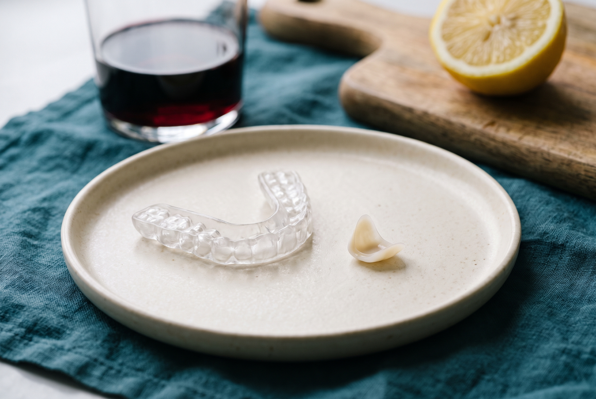

## RESPUESTA CORTA

Las carillas de porcelana necesitan el mismo cuidado que los dientes naturales, con tres cambios: una pasta dental no abrasiva, no morder cosas duras con los dientes frontales y una placa nocturna si rechinas. La porcelana no se mancha y no se puede blanquear, así que el tono con el que sales es el tono que conservas; blanquea tus dientes naturales antes de las carillas, no después. Cepíllate dos veces al día con un cepillo suave, usa hilo dental a diario en la línea de la encía y hazte una limpieza cada seis meses. Los provisionales, que llevas dos días, necesitan comida más blanda e hilo dental con más cuidado. Si una carilla se astilla o se despega, guarda el trozo y llama.

## Por qué el cuidado de las carillas es sobre todo cuestión de borde

Una carilla de porcelana no puede tener caries, no se mancha y no se desgasta al comer con normalidad. Lo que puede salir mal ocurre en su borde: la línea fina donde se encuentran porcelana, cemento, esmalte y encía. La placa bacteriana en esa línea causa inflamación de la encía y, con los años, caries en el diente natural bajo el margen. Por eso casi todas las reglas de abajo tratan de mantener limpio el margen y de no cargar la porcelana con impactos puntuales.

Los datos de fallos, y por qué importan los dos primeros años, están en [cuánto duran las carillas de porcelana](/es/blog/cuanto-duran-las-carillas-de-porcelana). Este artículo es la parte práctica: qué hacer cada día, qué comprar, qué dejar de hacer.

## La rutina diaria

- **Cepíllate dos veces al día con un cepillo suave o extrasuave.** Un cepillo eléctrico de cabezal redondo sirve; un cepillo manual suave sirve. Las cerdas duras y la presión excesiva no rayan la porcelana, pero sí desgastan la encía y la retiran del margen.
- **Usa una pasta dental no abrasiva.** Las pastas se clasifican por abrasividad en la escala RDA. Elige una por debajo de 70 aproximadamente y evita las de carbón, bicarbonato y las "blanqueadoras", que llevan los abrasivos gruesos que apagan el brillo con el tiempo. Una pasta blanqueadora no puede aclarar la porcelana de todos modos; solo la raya.
- **Usa hilo dental cada día, en la línea de la encía.** Desliza el hilo por cada lado del diente y bajo el borde de la encía, y sácalo. Los irrigadores son un buen complemento para los márgenes, no un sustituto del hilo.
- **Enjuágate sin alcohol.** El enjuague bucal con alcohol ablanda con los años el cemento de resina del margen. Un enjuague con flúor y sin alcohol protege el diente natural bajo el borde.
- **No muerdas cosas duras con los dientes frontales.** Hielo, cáscaras de frutos secos, caramelos duros, bolígrafos, uñas, chapas, envases. La porcelana aguanta masticar; no aguanta cargas puntuales y afiladas en el borde. Corta las manzanas y desgrana el maíz.

## ¿Las carillas se manchan? ¿Se pueden blanquear?

Dos de las preguntas más buscadas sobre carillas tienen respuestas cortas.

**La porcelana no se mancha.** El café, el té, el vino tinto, la cúrcuma y el humo del tabaco que oscurecen el esmalte se quedan sobre la superficie glaseada y se van con el cepillo. Las carillas de composite sí absorben las manchas, y es una de las razones por las que duran más o menos la mitad; la comparación está en [composite vs porcelana vs Lumineers](/es/blog/carillas-de-composite-vs-porcelana-vs-lumineers). Lo que sí puede oscurecerse en un caso de porcelana es la línea de cemento del margen, sobre todo en fumadores y grandes bebedores de café, y para eso está la limpieza semestral.

**La porcelana no se puede blanquear.** Los geles blanqueadores actúan atravesando el esmalte y aclarando la dentina de debajo. La porcelana está sellada; el gel no le hace nada. Eso tiene dos consecuencias. El tono que apruebas en el mock-up es permanente, y por eso lo igualamos con tu piel y el blanco de tus ojos a la luz del día y no con la pestaña más clara. Y si quieres tus dientes naturales más claros, blanquéalos dos semanas antes de la Visita 1 para que las carillas se igualen al resultado, o, en un caso de 20 carillas en el que se cubre cada diente visible, no queda nada que blanquear.

## Las primeras 48 horas después del cementado

El cemento se endurece con una lámpara de fotopolimerización en la Visita 3, así que puedes comer al salir. Unas pocas reglas en los dos primeros días hacen que la adhesión sea lo más fuerte posible.

| Horas tras el cementado | Haz | Evita |
| --- | --- | --- |
| 0 a 2 | No comer; la mordida se revisó en el sillón | Probar los bordes con los dedos o la lengua |
| 2 a 24 | Comida blanda a normal, bebidas tibias | Bebidas muy calientes o muy frías; comida pegajosa, chiclosa o crujiente; vino tinto y café mientras los márgenes terminan de sellar |
| 24 a 48 | Comer con normalidad | Morder alimentos duros con los dientes frontales; enjuague con alcohol |
| Después de 48 | Todo lo de la rutina diaria de arriba | Nada más; las carillas están tan fuertes como van a estar |

Una sensibilidad leve al frío es normal los primeros días y suele desaparecer en dos semanas. Cualquier punto que notes alto al morder, o un borde afilado que tu lengua no deja de encontrar, es un ajuste de dos minutos, no un problema; llama y se resuelve el mismo día si sigues en Miami, o guiado por teléfono y fotos si ya volaste a casa. Más sobre lo que se siente en cada visita en [¿duelen las carillas?](/es/blog/duelen-las-carillas).

## Carillas provisionales: los dos días entre la Visita 2 y la Visita 3

"Carillas provisionales" es una búsqueda grande por sí sola, y casi todo lo que aparece trata de fundas cosméticas de quitar y poner. Esto es distinto: tus provisionales son dientes de acrílico con la forma de tu diseño final, cementados ligeramente a tus dientes preparados el martes y sustituidos por porcelana el jueves. Están ahí para que convivas con el diseño, y para que los dientes preparados queden cubiertos.

También son más blandos que la porcelana y van sujetos con un cemento más débil a propósito, así que durante dos días:

- Come blando y córtalo todo pequeño. No muerdas sándwiches, manzanas ni bordes de pizza con los dientes frontales.
- Evita lo pegajoso, lo chicloso y lo crujiente: chicle, caramelo, frutos secos, pan duro, carne dura.
- Espera que se sientan algo abultados y que se note la unión entre dientes. Son una vista previa de forma y largo, no de acabado.
- Cepíllate con suavidad. Pasa el hilo deslizándolo hacia adentro y sacándolo de lado en lugar de tirar hacia arriba de golpe, que puede levantar un provisional.
- Comida y bebida tibias. Los dientes preparados son más sensibles a la temperatura hasta que llega la porcelana.
- Si un provisional se cae, guárdalo y llama. Se vuelve a cementar en minutos y al diente preparado no le pasa nada por unas horas destapado.

Usa los dos días para mirar. Di "más corto", "más estrecho" o "más cálido" el miércoles y el ceramista, que está en el edificio, ajusta la porcelana final antes de cementarla.

## Placa nocturna y rechinamiento

La porcelana es fuerte a la compresión y débil frente a la fuerza lateral, afilada y repetida, que es exactamente lo que es rechinar. Si rechinas o apretas los dientes, una placa nocturna a medida forma parte de tu plan y se usa todas las noches. Los doctores suelen detectar el rechinamiento en la Visita 1 por los bordes aplanados y las facetas de desgaste, incluso cuando el paciente nunca lo ha notado. Señales en casa: mandíbula tensa o dolor de cabeza por la mañana, una pareja que lo oye, bordes astillados en tus dientes naturales.

La placa se fabrica a partir de una impresión de tus carillas terminadas, así que encaja exactamente en los dientes nuevos. Guárdala seca en su estuche, cepíllala con jabón y agua, no con pasta dental, y llévala a tus limpiezas para que revisen el ajuste. Si practicas deportes de contacto, el protector deportivo es otra pieza, más gruesa y solo para jugar.

## Limpiezas, higienistas y dentistas en casa

Cada seis meses, una limpieza y una revisión, vivas donde vivas. Dos cosas que decirle a cualquier higienista o dentista que no te haya visto antes.

1. **Tienes carillas de porcelana en estos dientes.** Los higienistas pulen con una pasta; las pastas estándar son lo bastante abrasivas para apagar el glaseado. Pide una pasta de pulido no abrasiva y pide que las puntas del ultrasonido no toquen los márgenes de las carillas. El raspado manual en el margen no tiene problema.
2. **Conserva las radiografías.** Una radiografía de aleta de mordida cada uno o dos años muestra si empieza una caries bajo un margen mientras todavía es pequeña.

Los pacientes de fuera del estado conservan la garantía por escrito que se entrega en la Visita 3; indica qué cubre y cómo funciona una reclamación desde otra ciudad. El detalle está en [qué cubre realmente la garantía de unas carillas](/es/blog/garantia-de-carillas-que-cubre).

## Qué hacer si una carilla se astilla o se despega

Las astillas y los despegues son raros y casi siempre ocurren en los dos primeros años o tras un golpe. Si una carilla se desprende entera, guárdala, no intentes pegarla y llama; una carilla limpia normalmente se vuelve a cementar. Si se astilla, guarda el trozo y llama; las astillas pequeñas se pulen o se reparan con composite en el sillón, las grandes las rehace el ceramista a partir de tu archivo de diseño. Cubre cualquier borde afilado del diente con un poco de cera de ortodoncia de farmacia hasta que te vean, y evita masticar de ese lado.

## Los hábitos que les cuestan las carillas a la gente sin que se dé cuenta

- Abrir paquetes, morderse las uñas, masticar bolígrafos o hielo.
- Pasta de carbón o blanqueadora a diario.
- Enjuague con alcohol dos veces al día durante diez años.
- Saltarse la placa nocturna "porque solo aprieto un poco".
- Saltarse las limpiezas porque "la porcelana no tiene caries". La porcelana no; el diente bajo el borde sí.
- Fumar, que mancha el margen e inflama la encía de alrededor.

Ninguno de estos rompe una carilla en una semana. Cada uno acorta quince buenos años hacia ocho.

> La porcelana va a durar más que casi cualquier cosa que le hagas. La línea de la encía, no. Cuida el milímetro donde se juntan las dos y el resto se cuida solo.
>
> DR. ROGER RAMOS NAVARRO, DMD

Si estás decidiendo si las carillas son para ti, envía tres fotos a través de la [evaluación gratuita por fotos](/es/evaluacion-gratuita-por-fotos) y un doctor te responde en menos de 6 horas con un plan y un precio por escrito. Si ya tienes carillas nuestras y algo no se siente bien, usa el mismo formulario y dilo en las notas; un doctor responde el mismo día.

## Preguntas relacionadas

### ¿Qué pasta dental debo usar con carillas?

Cualquier pasta con flúor y baja abrasividad, por debajo de 70 aproximadamente en la escala RDA, con un cepillo suave. Evita las pastas de carbón, bicarbonato y blanqueadoras, que llevan abrasivos gruesos que apagan el glaseado con el tiempo y que, de todos modos, no pueden aclarar la porcelana.

Dr. Roger Ramos Navarro, DMD

### ¿Puedo tomar café con carillas?

Sí. La porcelana no absorbe manchas, así que el café, el té y el vino tinto se van de la superficie glaseada con el cepillo. Evita las bebidas muy calientes el primer día después del cementado y mantén las limpiezas cada seis meses para que la línea de cemento del margen siga limpia, porque es la única parte que un hábito fuerte de café puede oscurecer.

Dra. Gretell Alonso Fiel, DMD

### ¿Se pueden blanquear las carillas?

No. Los geles blanqueadores actúan a través del esmalte sobre la dentina de debajo, y la porcelana está sellada. El tono que apruebas en el mock-up es el tono que conservas. Si quieres tus dientes naturales más claros, blanquéalos dos semanas antes de la Visita 1 para que las carillas se igualen al resultado.

Dr. Roger Ramos Navarro, DMD

### ¿Puedo masticar chicle con carillas?

Con las carillas de porcelana definitivas, sí; el chicle sin azúcar no da problema. Con los provisionales que llevas entre la Visita 2 y la Visita 3, no. Los provisionales son de acrílico y van sujetos con un cemento más débil a propósito, y el chicle es la forma más común de que se caigan.

Dra. Marta Puentes Marrero, DMD

### ¿Tengo que usar placa nocturna con carillas?

Si rechinas o apretas los dientes, sí, todas las noches. La porcelana es débil frente a la fuerza lateral y repetida del rechinamiento, y los doctores suelen ver las facetas de desgaste en la Visita 1 incluso en pacientes que nunca lo notaron. Si no rechinas, no necesitas placa; el protector deportivo es otra pieza, para deportes de contacto.

Dr. Roger Ramos Navarro, DMD

### ¿Cómo uso el hilo dental con carillas?

Igual que con los dientes naturales: desliza el hilo por cada lado del diente y bajo el borde de la encía, y sácalo. Con los provisionales, saca el hilo de lado en lugar de tirar hacia arriba de golpe, que puede levantar un provisional. Un irrigador es un buen complemento para los márgenes, no un sustituto.

Dra. Gretell Alonso Fiel, DMD
