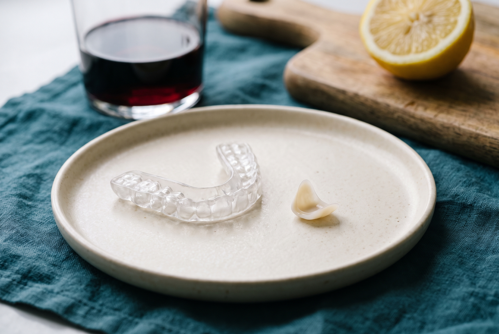

## SHORT ANSWER

Porcelain veneers need the same care as natural teeth, with three changes: a non-abrasive toothpaste, no biting hard things with your front teeth, and a night guard if you grind. Porcelain does not stain and cannot be whitened, so the shade you leave with is the shade you keep; whiten your natural teeth before the veneers, not after. Brush twice a day with a soft brush, floss daily at the gum line, and have a cleaning every six months. Temporaries, worn for two days, need softer food and gentler flossing. If a veneer chips or comes off, keep the piece and call.

## Why veneer care is mostly about the edge

A porcelain veneer cannot decay, cannot stain and cannot wear in normal eating. What can go wrong happens at its edge: the thin line where porcelain, cement, enamel and gum meet. Plaque at that line causes gum inflammation and, over years, decay in the natural tooth under the margin. That is why almost every rule below is about keeping the margin clean and not loading the porcelain with sharp impact.

The failure data, and why the first two years matter, are in [how long porcelain veneers last](/blog/how-long-do-porcelain-veneers-last). This article is the practical part: what to do every day, what to buy, what to stop doing.

## The daily routine

- **Brush twice a day with a soft or extra-soft brush.** An electric brush with a round head is fine; a soft manual brush is fine. Hard bristles and heavy pressure do not scratch porcelain but they do wear the gum away from the margin.
- **Use a non-abrasive toothpaste.** Toothpaste is rated for abrasiveness on the RDA scale. Pick one under about 70 and avoid charcoal, baking-soda and "whitening" pastes, which carry the gritty abrasives that dull glaze over time. Whitening toothpaste cannot lighten porcelain anyway; it only scratches it.
- **Floss every day, at the gum line.** Slide the floss down each side of the tooth and under the gum edge, then out. Water flossers are a good addition for the margins, not a replacement for floss.
- **Rinse without alcohol.** Alcohol-based mouthwash softens the resin cement at the margin over years. An alcohol-free fluoride rinse protects the natural tooth under the edge.
- **Do not bite hard things with your front teeth.** Ice, nutshells, hard candy, pens, fingernails, bottle caps, packaging. Porcelain handles chewing; it does not handle sharp point loads at the edge. Cut apples and corn off the cob.

## Do veneers stain? Can they be whitened?

Two of the most searched veneer questions have short answers.

**Porcelain does not stain.** Coffee, tea, red wine, turmeric and tobacco smoke that discolour enamel sit on the glazed surface and brush off. Composite veneers do absorb stain, which is one reason they last about half as long, and the comparison is in [composite vs porcelain vs Lumineers](/blog/composite-vs-porcelain-veneers-vs-lumineers). What can discolour on a porcelain case is the cement line at the margin, especially in smokers and heavy coffee drinkers, which is what the six-month cleaning is for.

**Porcelain cannot be whitened.** Bleaching gels work by passing through enamel and lightening the dentine underneath. Porcelain is sealed; the gel does nothing to it. That has two consequences. The shade you approve at the mock-up is permanent, which is why we match it against your skin and the whites of your eyes in daylight rather than against the brightest tab. And if you want your natural teeth brighter, whiten them two weeks before Visit 1 so the veneers are matched to the result, or, in a 20-veneer case where every visible tooth is covered, there is nothing left to whiten.

## The first 48 hours after bonding

The cement is set with a curing light at Visit 3, so you can eat when you leave. A few rules for the first two days make the bond as strong as it can be.

| Hours after bonding | Do | Avoid |
| --- | --- | --- |
| 0 to 2 | Nothing to eat; the bite was checked in the chair | Testing the edges with your fingers or tongue |
| 2 to 24 | Soft to normal food, lukewarm drinks | Very hot or very cold drinks; sticky, chewy or crunchy food; red wine and coffee while the margins finish sealing |
| 24 to 48 | Normal eating | Biting hard foods with the front teeth; alcohol mouthwash |
| After 48 | Everything in the daily routine above | Nothing else; the veneers are as strong as they will be |

Mild sensitivity to cold is normal for the first days and usually settles within two weeks. Anything that feels high when you bite, or a sharp edge your tongue keeps finding, is a two-minute adjustment, not a problem; call and it is done the same day if you are still in Miami, or guided by phone and photos if you have flown home. More on what each visit feels like is in [do veneers hurt](/blog/do-veneers-hurt).

## Temporary veneers: the two days between Visit 2 and Visit 3

"Temporary veneers" is a large search on its own, and most of what comes up is about snap-on cosmetic covers. These are different: your temporaries are acrylic teeth in the shape of your final design, bonded lightly to your prepared teeth on Tuesday and replaced with porcelain on Thursday. They are there so you can live with the design, and so the prepared teeth are covered.

They are also softer than porcelain and held on with weaker cement on purpose, so for two days:

- Eat soft food and cut everything small. No biting into sandwiches, apples or pizza crusts with your front teeth.
- Avoid sticky, chewy and crunchy food: gum, caramel, nuts, hard bread, tough meat.
- Expect them to feel slightly bulky and to show the join between teeth. They are a preview of shape and length, not of finish.
- Brush gently. Floss by sliding the floss in and pulling it out sideways rather than snapping it back up, which can lift a temporary.
- Lukewarm food and drink. Prepared teeth are more sensitive to temperature until the porcelain is on.
- If a temporary comes off, keep it and call. It is re-bonded in minutes and the prepared tooth is not harmed by a few hours uncovered.

Use the two days to look. Say "shorter", "narrower" or "warmer" on Wednesday and the ceramist, who is in the building, adjusts the final porcelain before it is bonded.

## Night guards and grinding

Porcelain is strong in compression and weak against sharp, repeated, sideways force, which is exactly what grinding is. If you grind or clench, a custom night guard is part of your plan and is worn every night. The doctors usually see grinding at Visit 1 from flattened edges and wear facets even when the patient has never noticed it. Signs at home: a tight jaw or headache in the morning, a partner who hears it, chipped edges on your natural teeth.

A guard is made from an impression of your finished veneers, so it fits the new teeth exactly. Store it dry in its case, brush it with soap and water, not toothpaste, and bring it to your cleanings so the fit is checked. If you play contact sports, a sports mouthguard is a separate item, thicker and worn only during play.

## Cleanings, hygienists and dentists at home

Every six months, a cleaning and checkup, wherever you live. Two things to tell any hygienist or dentist who has not seen you before.

1. **You have porcelain veneers on these teeth.** Hygienists polish with a paste; the standard pastes are abrasive enough to dull glaze. Ask for a non-abrasive polishing paste, and ask that ultrasonic scaler tips be kept off the veneer margins. Hand scaling at the margin is fine.
2. **Keep the X-rays.** A bitewing X-ray every one to two years shows whether decay is starting under a margin while it is still small.

Out-of-state patients keep the written warranty handed over at Visit 3; it states what is covered and how a claim works from another city. The detail is in [what a veneer warranty actually covers](/blog/veneer-warranty-what-it-covers).

## What to do if a veneer chips or comes off

Chips and debonds are rare and almost always happen in the first two years or after an impact. If a veneer comes off whole, keep it, do not try to glue it, and call; a clean veneer is usually re-bonded. If it chips, keep the piece and call; small chips are polished or repaired with composite in the chair, larger ones are remade by the ceramist from your design file. Cover any sharp edge on the tooth with a little orthodontic wax from a pharmacy until you are seen, and avoid chewing on that side.

## The habits that quietly cost people their veneers

- Opening packages, biting nails, chewing pens or ice.
- Charcoal or whitening toothpaste used daily.
- Alcohol mouthwash twice a day for ten years.
- Skipping the night guard "because I only clench a little".
- Skipping cleanings because "porcelain cannot decay". The porcelain cannot; the tooth under the edge can.
- Smoking, which stains the margin and inflames the gum around it.

None of these breaks a veneer in a week. Each one shortens fifteen good years toward eight.

> The porcelain will outlast almost anything you do to it. The gum line will not. Look after the millimetre where the two meet and the rest looks after itself.
>
> DR. ROGER RAMOS NAVARRO, DMD

If you are deciding whether veneers are right for you, send three photos through the [free photo evaluation](/free-photo-evaluation) and a doctor replies within 6 hours with a plan and a written price. If you already have veneers from us and something feels off, use the same form and say so in the notes; a doctor answers the same day.

## Related questions

### What toothpaste should I use with veneers?

Any fluoride toothpaste with a low abrasiveness rating, under about 70 on the RDA scale, used with a soft brush. Avoid charcoal, baking-soda and whitening pastes, which carry gritty abrasives that dull the glaze over time and cannot lighten porcelain anyway.

Dr. Roger Ramos Navarro, DMD

### Can I drink coffee with veneers?

Yes. Porcelain does not absorb stain, so coffee, tea and red wine brush off the glazed surface. Avoid very hot drinks for the first day after bonding, and keep up six-month cleanings so the cement line at the margin stays clean, because that is the only part a heavy coffee habit can discolour.

Dr. Gretell Alonso Fiel, DMD

### Can you whiten veneers?

No. Bleaching gels work through enamel on the dentine underneath, and porcelain is sealed. The shade you approve at the mock-up is the shade you keep. If you want your natural teeth brighter, whiten them two weeks before Visit 1 so the veneers are matched to the result.

Dr. Roger Ramos Navarro, DMD

### Can I chew gum with veneers?

With the final porcelain veneers, yes; sugar-free gum is fine. With the temporaries worn between Visit 2 and Visit 3, no. Temporaries are acrylic held with weaker cement on purpose, and gum is the most common way they come off.

Dr. Marta Puentes Marrero, DMD

### Do I have to wear a night guard with veneers?

If you grind or clench, yes, every night. Porcelain is weak against the sideways, repeated force of grinding, and the doctors usually see the wear facets at Visit 1 even in patients who never noticed. If you do not grind, no guard is needed; a sports mouthguard is a separate item for contact sports.

Dr. Roger Ramos Navarro, DMD

### How do I floss with veneers?

The same as natural teeth: slide the floss down each side of the tooth and under the gum edge, then out. With the temporaries, pull the floss out sideways rather than snapping it back up, which can lift a temporary. A water flosser is a good addition for the margins, not a replacement.

Dr. Gretell Alonso Fiel, DMD
